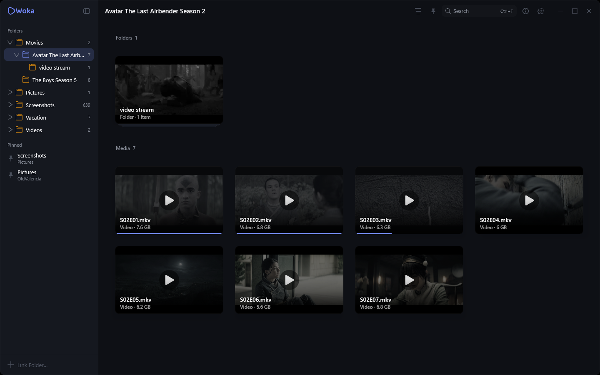
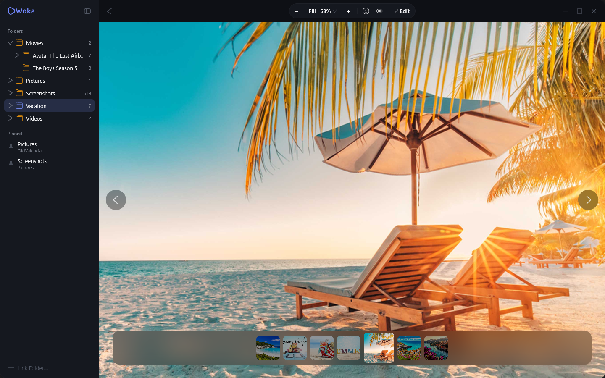
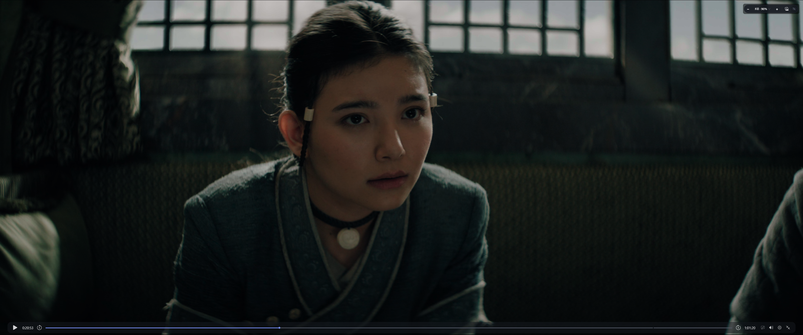

<p align="center">
  
</p>

<p align="center">
  <b>A minimalist, lightning-fast, and aesthetic desktop media viewer & editor.</b><br/>
</p>

<p align="center">
  
  
  
  
  <a href="https://github.com/OldValencia/Woka"></a>
</p>

---

## Overview

### Main Window — Library & Folder Navigation
Fluid sidebar navigation with pinned shortcuts, smart folder stack previews, and responsive media grid.

<p align="center">
  
</p>

<br/>

### Photo Viewer — Color Fidelity & Deep Zoom
Hardware-accelerated Skia rendering with HDR tone-mapping, ambient background illumination, and quick frame strips.

<p align="center">
  
</p>

<br/>

### Video Player — Precision Playback & Subtitles
FFmpeg-powered playback engine with frame-accurate scrubbing, multi-track audio, subtitle rendering (SRT, ASS), and Picture-in-Picture.

<p align="center">
  
</p>

---

## Key Features

- **Local-First & Private:** Everything runs on your machine. Zero telemetry, no mandatory cloud accounts, and no data tracking.
- **Fast Media Browsing:** Instantly traverse folders containing thousands of high-resolution stills and raw clips without UI stalls.
- **Fluid Inspection & Zoom:** Smooth sub-pixel pan and zoom gestures (`Ctrl` + scroll, trackpad pinch) with auto-centering and fit presets.
- **True HDR & Wide Color:** Skia-powered tone-mapping pipeline for HDR10, PQ, and HLG content, displaying accurate highlights and shadows on any display.
- **High-Performance Video Playback:** Powered by JavaCV and Bytedeco FFmpeg. Handles HEVC, AV1, VP9, ProRes, and H.264 up to 4K/8K with low CPU overhead.
- **Subtitles & Multi-Track Audio:** Full subtitle stream extraction (SRT, ASS, VTT) with configurable styling, language selection, and volume boost.
- **Picture-in-Picture (PiP):** Detach any video into an independent, borderless floating window that stays on top while you browse other folders.
- **Built-in Precision Image Editing:** Crop, rotate, color adjustments (brightness, contrast, saturation).
- **Keyboard-Driven Workflow:**
  - `Space` — Quick Look preview
  - `Esc` — To deselect item
  - `Arrow keys` — To select items
  - `Enter` / Double Click — Open in full viewer
  - `Ctrl + F` — Quick library search
  - `Ctrl + I` — Detailed EXIF & video stream metadata
  - `P` — Picture-in-Picture toggle
  - `F` / Double Click — Fullscreen mode

---

## Supported Formats

Woka is built to replace bloated third-party viewers with a single, lightning-fast local media player and viewer supporting **62 media formats** natively.

### 🖼️ Images & Graphics (27 formats)

| Category | Extensions | Capabilities |
| :--- | :--- | :--- |
| **Standard Raster** | `.jpg`, `.jpeg`, `.jfif`, `.jpe`, `.png`, `.webp`, `.bmp`, `.dib`, `.rle`, `.gif` | Viewing, frame extraction, built-in non-destructive editor (crop, rotate, adjust) |
| **Modern & High-Efficiency** | `.heic`, `.heif`, `.hif`, `.avif` | Hardware-accelerated decode, HDR tone mapping, burst/multi-frame support, editor |
| **High-Fidelity & Print** | `.tif`, `.tiff` | Multi-page TIFF navigation, high dynamic range viewing & editing |
| **Netpbm & Graymaps** | `.pbm`, `.pgm`, `.ppm` | Portable AnyMap format suite support via FFmpeg |
| **Game Textures & Legacy** | `.tga`, `.qoi`, `.jp2`, `.pcx` | Instant viewing, fast thumbnail caching via Skia/FFmpeg pipeline |
| **Vector Graphics** | `.svg` | Skia-powered vector rendering (viewing only) |
| **Adobe Photoshop** | `.psd`, `.psdt`, `.pdd` | **Read-only**: Full-quality composite preview of Photoshop documents |

### 🎬 Video (35 formats)

Powered by bundled **FFmpeg 8.x** with frame-accurate scrubbing and hardware-accelerated playback:

| Category | Extensions | Features |
| :--- | :--- | :--- |
| **Modern & Web Video** | `.mp4`, `.m4v`, `.mov`, `.webm`, `.mkv`, `.mk3d` | 4K/8K playback, HDR (PQ/HLG), multi-track audio, subtitles (SRT, ASS, VTT), Picture-in-Picture |
| **Broadcast & Transport Streams** | `.ts`, `.m2ts`, `.mts`, `.tp`, `.tod`, `.rec` | MPEG transport stream demuxing, multi-channel audio, frame-accurate seeking |
| **Optical Disc & Production** | `.vob`, `.vro`, `.evo`, `.mxf` | DVD Video Object, Enhanced VOB, broadcast Material Exchange Format |
| **MPEG Standards** | `.mpg`, `.mpeg`, `.mpeg1`, `.mpeg2`, `.mpeg4`, `.mpg4`, `.mpv`, `.mpv2` | MPEG-1/2/4 video streams and elementary streams |
| **Windows Media & Legacy PC** | `.avi`, `.wmv`, `.asf`, `.divx`, `.gvi` | AVI, Windows Media Video, Advanced Systems Format, DivX, Google Video |
| **Flash & Streaming** | `.flv`, `.f4v` | Flash Video and Flash MP4 containers |
| **Mobile & Telecom** | `.3gp`, `.3g2` | 3GPP and 3GPP2 mobile multimedia containers |
| **Specialized & Open Formats** | `.dv`, `.drc` | Digital Video and Dirac container/codecs |

---

## Architecture

| Layer | Technologies |
| :--- | :--- |
| **UI Framework** | [Compose Multiplatform](https://github.com/JetBrains/compose-multiplatform) (Desktop / JVM) |
| **Graphics Engine** | [Skia](https://skia.org/) (via Skiko & Compose) for hardware-accelerated image pipeline and tone-mapping |
| **Video Engine** | [JavaCV](https://github.com/bytedeco/javacv) (FFmpeg native bindings) for high-efficiency demuxing and decoding |
| **Dependency Injection** | [Koin](https://insert-koin.io/) |
| **Reactive State** | Kotlin Coroutines & `StateFlow` |

---

## Getting Started

### Prerequisites

- **JDK 25** or higher (Oracle JDK, OpenJDK, Temurin, or Corretto recommended)
- **Windows 10/11** (officially tested and supported)

> [!NOTE]
> macOS and Linux support is currently experimental and untested. While the project is built on Compose Multiplatform and should theoretically run on other desktop OSes, daily development and testing are conducted primarily on Windows.

### Running from Source

Clone the repository and launch via Gradle:

```bash
# Clone the repository
git clone https://github.com/OldValencia/Woka.git
cd Woka

# Standard run
./gradlew :desktopApp:run

# Development run with hot reload
./gradlew :desktopApp:hotRun --auto
```

On Windows PowerShell:
```powershell
.\gradlew.bat :desktopApp:run
```

---

## Contributing & Support

Contributions, feedback, and bug reports are welcome! Feel free to open an issue or submit a pull request on GitHub.

If you enjoy using Woka, consider supporting ongoing development:

- 💖 **GitHub Sponsors:** [sponsor @OldValencia](https://github.com/sponsors/OldValencia)
- ☕ **Buy Me a Coffee:** [buymeacoffee.com/oldvalencia](https://buymeacoffee.com/oldvalencia)
- 🍵 **Ko-fi:** [ko-fi.com/oldvalencia](https://ko-fi.com/oldvalencia)

---

## License

This project is licensed under the [MIT License](LICENSE).