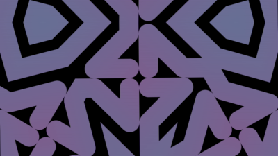
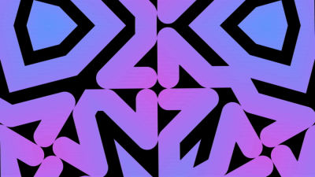

# Dolby Vision, тёмные постеры и 8K: результаты исследования

**Дата:** 2026-11-10. **Статус:** измерения для разработки 1.0.8; исправления не реализованы.
Источник задач — `next_steps.md`, раздел 1.0.8. Сэмплы: `D:/Movies/DV samples`.
Код приложения при исследовании не менялся. Результаты относятся к текущему дереву, JavaCV 1.5.14,
встроенному FFmpeg 8.1.2-1.5.14 и этой машине с RTX 5080 / NVIDIA 596.49.

## 1. Что установлено

1. **Неверные цвета Profile 5:** оба проблемных файла распознаются текущим кодом как SDR.
   Их данные Dolby Vision доступны, но не участвуют в выборе цветового преобразования.
   Простого включения обычного HDR-тон-маппинга для P5 недостаточно.
2. **Тёмный постер P8.1:** неподвижный постер сохраняется без HDR-тон-маппинга, а плеер его применяет.
   На одинаковом кадре различие воспроизведено численно и сохранено в PNG.
   Анимация при наведении уже использует HDR-шейдер; это отдельный путь.
3. **Тормоза 8K/60:** основной измеренный предел короткой пробы — преобразование в RGBA и подготовка bitmap.
   Сам программный декод успевал в 60 fps на тех 48 кадрах; длинный повтор (§7) этого не подтверждает.
   GPU-декод с возвратом полноразмерных кадров в RAM сам по себе проблему не решает.

Это три отдельных задачи. Поддержка P5 не исправит производительность 8K, а выбор GPU не добавит
отсутствующий тон-маппинг постеру.

## 2. Сэмплы и измеренная классификация

Все 16 файлов каталога обследованы системным `ffprobe 8.0`: поток, частота кадров, DV configuration.
Шесть файлов ниже дополнительно открыты встроенным FFmpeg через `DolbySampleProbe`.

| Файл | Размер / fps | trc / primaries / matrix | DV profile / compatibility | Текущий `readHdrInfo` |
|---|---|---|---|---|
| Mystery Box Dolby Vision Profile 5.mp4 | 3840×2160 / 59.94 | 2 / 2 / 2 | 5 / 0 | SDR, не wide gamut |
| Test Jellyfin 1080p DV P5.mp4 | 1920×1080 / 60 | 2 / 2 / 2 | 5 / 0 | SDR, не wide gamut |
| Test Jellyfin 4K DV P8.1.mp4 | 3840×2160 / 60 | 16 / 9 / 9 | 8 / 1 | PQ + BT.2020 |
| Test Jellyfin 4K DV P8.4.mp4 | 3840×2160 / 60 | 18 / 9 / 9 | 8 / 4 | HLG + BT.2020 |
| Test Jellyfin 8K HEVC 10bit 150M.mp4 | 7680×4320 / 60 | 2 / 1 / 1 | нет | SDR |
| Test Jellyfin 8K HEVC HDR10 150M.mp4 | 7680×4320 / 60 | 16 / 9 / 9 | нет | PQ + BT.2020 |

`2` означает unspecified. У P5 диапазон full (`color_range=2`); у остальных строк — limited.
Полная инвентаризация находится в `shared/build/dv-investigation/inventory.csv`.
Другие DV-файлы каталога действительно неоднородны: `DVprofile10.mkv` — AV1 Profile 10;
`4K60p.mov` — HEVC Profile 8 / compatibility 4; `awaken-girl...` и `Hybrid HDR10Plus DV Sample.mkv`
— Profile 7 / compatibility 6. Нельзя определять профиль по имени файла или считать любой DV-файл P5.
Их корректность на экране отмечена автором в `next_steps.md`; визуальный прогон всех 16 здесь не повторялся.

## 3. Profile 5: причина неправильных цветов

### Подтверждено кодом и пробой

`HdrInfo.kt:readHdrInfo` принимает только `color_trc` и `color_primaries` и не читает DV configuration.
На двух P5-файлах получается `HdrInfo(transfer=SDR, isWideGamut=false)`. В `rememberFramePainter`
HDR-путь выбирается только при `needsColorManagement`; следовательно, эти файлы проходят мимо него.

JavaCV `FFmpegFrameGrabber.processImage` преобразует декодированный `yuv420p10le` через обычный
`sws_getCachedContext` / `sws_scale` в 8-битный RGB(A). Обработки RPU или специального P5-преобразования
в этом пути нет. Это соответствует подтверждённым автором зелёным/фиолетовым оттенкам.

У P5 базовый сигнал — **IPT-PQ-C2**, а не обычный HDR10 YCbCr. Отсутствующие VUI-теги допустимы
для этого профиля; обработка включает reshaping. Поэтому подмена unspecified на PQ/BT.2020
и запуск существующего шейдера не являются полноценным исправлением.
Источник: [официальные пояснения Dolby к Profile 5](https://ott.dolby.com/OnDelKits/Dolby_Vision_Online_Delivery_Kit/v1/Documentation/Specs/Visio_Profiles/help_files/topics/c_notes_profile_public.html).

### Доступность метаданных — лучше, чем предполагалось

Встроенный FFmpeg отдаёт:

- В `AVCodecParameters.coded_side_data`: `AV_PKT_DATA_DOVI_CONF`.
  Проба через `av_packet_side_data_get` прочитала profile 5 / compatibility 0 у обоих файлов.
- В декодированных кадрах: `Dolby Vision RPU Data` и `Dolby Vision Metadata`.
  У Mystery Box размер RPU на 1 / 5 / 10 секундах — 158 / 245 / 246 байт;
  у Jellyfin 1080p — 200 / 200 / 200 байт. CRC меняется между позициями у обоих файлов.
  Значит, доступен реальный меняющийся RPU, а не пустой контейнерный признак.
- Разобранный native-блок DV metadata — 7848 байт в проверенных кадрах.

Но Java-классов `AVDOVIDecoderConfigurationRecord`, `AVDOVIMetadata`, `AVDOVIColorMetadata`
в текущих Bytedeco bindings нет. Это **отсутствие обёрток**, а не отсутствие данных в FFmpeg.
Не делать вывод «RPU прочитать невозможно» из одного неудачного `Class.forName`.

В пробе байтовые поля конфигурации прочитаны по проверенному заголовку версии 8.1.
Размер структуры не является стабильным ABI; перенос такого чтения и особенно случайных смещений
внутри сложной DV metadata в приложение не одобрен. Для разработки нужен проверяемый bridge/bindings
или отдельный корректный разбор RPU.
Источник: [FFmpeg 8.1, `dovi_meta.h`](https://ffmpeg.org/doxygen/8.1/dovi__meta_8h_source.html).

**Уточнение старых документов:** во встроенной текущей сборке найдены фильтры `zscale` и `tonemap`;
`libplacebo` отсутствует. Утверждение старого HDR-плана про отсутствие `zscale` относилось к прежней
сборке и не описывает текущую. Наличие `zscale` само по себе не добавляет P5 reshaping.

### Направление разработки

1. Распознавать профиль и compatibility из configuration до обычной HDR-классификации.
2. Для P5 отдельно обработать native-компоненты, range и RPU, затем передать результат в общий
   тон-маппинг. Не считать вход существующего RGB-шейдера исходными IPT-компонентами: JavaCV уже
   сделал обычную YUV→RGB-конвертацию. Возможную потерю информации/клиппинг этого промежуточного
   преобразования нужно исключить до реализации исправления поверх него.
3. Проверить reshaping и матрицы на известном корректном эталоне. В этой работе эталонный P5
   рендер не строился и точная последовательность матриц/коэффициентов не утверждалась.
4. Пока правильного пути нет — честно сообщать о неподдерживаемом P5 вместо неверных цветов.
   Исправление не должно ломать совместимые PQ/HLG-слои P8.1 / P8.4 и текущие P7/P10 сценарии.

## 4. P8.1: почему неподвижный постер темнее

### Подтверждённое расхождение путей

- `VideoThumbnailExtractor.extract`: BGR24 → `Java2DFrameConverter` → уменьшение до 400 px → WebP.
  Чтения HDR-информации и тон-маппинга перед сохранением нет.
- `MediaThumbnails` / `editedPoster`: без правок фильма возвращают этот постер как есть.
- `FolderCardVideoCover.VideoCover`: рисует обычный bitmap. HDR-шейдера здесь нет.
- Плеер использует `HdrImagePainter` с PQ, BT.2020 и пиком из кадра.
  В этом сэмпле MaxCLL=244, MaxFALL=145, mastering peak=1000 нит;
  `declaredWhitePoint()` даёт **2.44** в единицах SDR white.

Это не просто предположение о разных белых точках: в постерном пути отсутствует само преобразование.

`DolbyPosterProbe` сравнивает **один и тот же** кадр в 400×225: необработанные RGB-коды и действующий
`HdrImagePainter` с whitePoint=2.44. Не сравнивались разные случайно выбранные сцены или старые WebP.

| Позиция | Средняя яркость без преобразования | Через painter плеера | Пик без / после |
|---|---:|---:|---:|
| 5 с | 89.38 | 108.68 | 106.78 / 135.76 |
| 10 с | 76.56 | 95.93 | 112.97 / 147.09 |
| 20 с | 76.56 | 95.92 | 112.97 / 147.09 |

Яркость — средневзвешенные отображаемые RGB-коды по Rec.709, шкала 0–255; **не физические ниты**.
Пример на 10 секунде:

| Без тон-маппинга | Через painter плеера |
|---|---|
|  |  |

Дополнительно карточка намеренно приглушается: `FolderCardPreview` задаёт насыщенность 0.62 и
чёрный overlay 18% в покое. Для просмотренного видео `VideoCover` может применять alpha 0.55 и
насыщенность 0.25. Эти эффекты усиливают отличие от плеера, но не объясняют отсутствие тон-маппинга.
При проверке исправления отделить дизайн карточки от корректности исходного постера.

**Анимация при наведении отличается:** `HoverExcerptReel` читает HDR и white point, а
`VideoHoverExcerpts.jvm.kt` вызывает `rememberFramePainter(..., moving=true)`. Ей нельзя добавлять
второй тон-маппинг заодно с исправлением постера. Динамический HDR10+ этот путь отдельно не проверялся.

Для будущего исправления: сформировать корректный SDR-постер перед кэшированием, согласованный
с выбранной политикой HDR; не тон-маппить его повторно в UI. Продумать инвалидирование уже сохранённых
неправильных WebP. Определить, должен ли глобальный HDR Auto/On/Off менять постер, и проверить правки
фильма поверх преобразования. Эти продуктовые решения здесь не принимались.

## 5. 8K/60: где теряется время

### Метод

`EightKStagesProbe`, оба файла `Test Jellyfin 8K HEVC {10bit,HDR10} 150M.mp4`.
Четыре потока декодера, 8 прогревочных + 48 измеренных кадров, каждый вариант с новым grabber.
Измерены software `hevc` и native HEVC с CUDA из пробы ME-236; native / 3840 / 1920 px на выходе.
Проба не читает звук, не ждёт реального времени и не намеренно пропускает кадры.

Для software отдельно замерены `grabFrame(..., doProcessing=false)`, JavaCV `processImage` и
подготовка bitmap. Последняя повторяет `FramePacer.convert`: новая `ByteArray`, копия RGBA-буфера,
`Bitmap.installPixels`, immutable. Bitmap сразу закрывается; очередь UI не моделируется.
Для CUDA счётчик pipeline включает декод, download и RGB-конвертацию вместе; разделять эти три
затраты данным таймером нельзя. Чистый CUDA-декод замерен отдельно, без download.

### Результат

| Путь, до вывода в окно | 8K 10bit SDR | 8K HDR10 |
|---|---:|---:|
| Software, только декод | 71.0 fps | 79.3 fps |
| CUDA, только декод, без возврата пикселей | 175.3 fps | 175.4 fps |
| Software → RGBA 7680 → bitmap | 14.7 fps | 15.0 fps |
| Software → RGBA 3840 → bitmap | 43.8 fps | 45.1 fps |
| Software → RGBA 1920 → bitmap | 56.5 fps | 59.2 fps |
| CUDA → download → RGBA 7680 → bitmap | 12.6 fps | 12.7 fps |
| CUDA → download → RGBA 3840 → bitmap | 31.8 fps | 32.0 fps |
| CUDA → download → RGBA 1920 → bitmap | 44.7 fps | 44.8 fps |

Бюджет 60 fps — **16.67 мс на кадр**. В software/native варианте:

- RGB-конвертация: **43.72 / 43.02 мс** для SDR / HDR10.
- Подготовка bitmap: **24.31 / 23.54 мс**.
- Суммарный измеренный pipeline: **68.22 / 66.73 мс**.

Не складывать сюда ещё раз независимые 12.6–14.1 мс чистого декода: frame threading выполняет
часть декодирования параллельно RGB-конвертации. Поэтому время `grabFrame` внутри медленного
полного software pipeline составляет только ~0.2 мс; это ожидание уже подготовленного кадра,
а не доказательство, что HEVC-декод стоит 0.2 мс CPU.

Один 8K RGBA-кадр — 132 710 400 байт (~126.6 MiB), при 60 fps это ~7.96 GB/s только одного
полного прохода по этим байтам. В текущем пути есть преобразование, staging и bitmap-копия.
Аппаратный декод, за которым следуют download и те же CPU-операции, эту работу не убирает.
Измеренный результат подтверждает: для этих сэмплов он может сделать полный путь медленнее.

**Вывод для ME-236:** улучшение long-GOP pre-roll из предыдущего замера остаётся верным,
но не означает, что простое включение CUDA исправит 8K/60.

### Направление разработки и пределы вывода

1. Сначала измерить реальную ширину RGBA-выхода и времена стадий в работающем приложении,
   особенно в fullscreen/HiDPI. `RenderScale` уже уменьшает выход под поверхность; проверить,
   не остаётся ли native 8K и какой размер действительно нужен.
2. Исследовать более дешёвую YUV/P010→RGB-конвертацию и отсутствие лишнего кругового пути
   GPU→RAM→GPU. Оценить загрузку исходных плоскостей и преобразование в шейдере либо аппаратное
   уменьшение перед download. Конкретная архитектура ещё не выбрана.
3. Замерить копии/аллокатор/GC и upload в живом плеере; сохранить правила владения bitmap.
   Не убирать staging и освобождение кадров без проверки нативной памяти: предыдущие утечки
   и их причины описаны в `FramePacer` / `FrameRetention`.
4. Повторить цвета и HDR metadata после оптимизации; быстрота не должна возвращать проблему CUVID
   с потерей side data, описанную в [замере ME-236](video-editor/playback/playback.md#measured--me-236-2026-11-10).

Это **не измеренный fps окна приложения**: GPU upload, HDR draw, presenter, звук и взаимодействие
с UI не включены. JVM теста имеет `-Xmx512m`, приложение — `-Xmx1536m` и `MaxNewSize=256m`;
стоимость GC в приложении может отличаться. Прогон короткий, на прогретых данных, без статистики
долгой сессии. Тем не менее уже одна RGB-конвертация в native размере превышает бюджет кадра
более чем вдвое; объявлять единственной причиной «не хватает HEVC-декодера» оснований нет.

## 6. Повторение и сохранённые материалы

```powershell
./gradlew.bat :shared:jvmTest --rerun --tests "*DolbySampleProbe" --tests "*DolbyPosterProbe" --tests "*EightKStagesProbe" --info
```

Пробы — `shared/src/jvmTest/kotlin/com/woka/probe/`, три одноимённых файла. Пробы сообщают результаты;
зелёный Gradle сам по себе не подтверждает каждый capability — читать строки FAILED и отчёты.
Последний полный запуск трёх проб завершился `BUILD SUCCESSFUL`; после исправления оформления
проверки bindings отдельно повторно прошёл `DolbySampleProbe`.

`shared/build/dv-investigation/`: `metadata.txt`, `8k-stages.txt`, `inventory.csv`, JSON от ffprobe,
бинарные RPU, `poster/results.txt`, PNG до/после и журналы Gradle. Каталог build можно удалить;
основные результаты и две иллюстрации сохранены рядом с этой документацией.

Проверки для будущего исправления: оба P5 с эталоном корректных цветов; неподвижный постер и
hover на одинаковом кадре с плеером; инвалидация старого кэша; 8K SDR и HDR10 при 60 fps на реальном
размере поверхности; HDR/DV side data, смена размера/перемотка/закрытие и длительный расход памяти.

## 7. Повторное исследование живого вывода — 2026-11-11

Автор разрешил исследование двух 8K/150M-файлов. **Поправка автора:** лаги есть и в маленьком
окне; один запуск показался плавным. Гипотеза «только fullscreen» отозвана.
Показатели ниже — наблюдения автора, не инструментальный замер агента. Автор уточнил:
IntelliJ → `:desktopApp:run`, монитор 3440×1440, режим Fit, штатный размер маленького окна.
AWT в пробе сообщил масштаб 1.0×1.0. `main.kt:defaultWindowSize` даёт здесь 1440×900.

| Сценарий | CPU, % | RAM, МБ (как сообщил автор) |
|---|---:|---:|
| Простой | 0 | 863 |
| HDR10, маленькое окно | 25 | 2300–2400 |
| HDR10, fullscreen | 25 | 2500–2700 |
| 10bit SDR, маленькое окно | 25–37 | 2500–2700 |
| 10bit SDR, fullscreen | 23–25 | 2900–3100 |

### План замера в рамках согласованного пункта 3

1. Проверить `RenderScale`, порядок decode/conversion/drop и владение bitmap без изменения
   production-кода. Установлено по коду: `grabFrame(..., doProcessing=true)` предшествует
   `FramePacer.shouldSkip`; пропуск экономит bitmap, но уже не RGBA-конвертацию.
2. Добавить только диагностические файлы в `jvmTest/probe/`: `EightKPlaybackProbe.kt`,
   `EightKProbeWindow.kt`, `EightKProbeMetrics.kt`, `EightKRepeatStagesProbe.kt`.
   Опт-ин через `woka.probe.8k`; исходные файлы только читаются, настройки изолированы.
3. Настоящие `VideoPlayerState` и `MediaViewerContent` в ComposeWindow: два прохода по обоим
   файлам, маленькая поверхность → поверхность размером с экран → маленькая. Каждый этап
   начинает тот же участок после seek, прогрев отдельно от измерения. Записать реальные
   размеры RGBA, уникальные нарисованные frame id, интервалы draw, CPU процесса, heap/GC.
   JVM-флаги памяти как у приложения; JFR сохранить для анализа задержек. Это отдельное
   окно с компонентом просмотра, не вся оболочка приложения и не её переход fullscreen.
4. Отдельная повторная проба: decode, JavaCV processImage и bitmap staging, распределения
   времени и GC. Сначала 1920/3840, после уточнения экрана — чистый декод и 1440/2560.
   Она не включает GPU upload и не заменяет оконный замер.
5. По результатам выбрать следующую оптимизацию. Не менять lifetime, декодер, цвета или
   GPU-архитектуру в рамках диагностики. CPU-время draw не выдавать за GPU completion;
   heap не выдавать за полную RAM. Непроверенные причины межзапусковой разницы оставить открытыми.

### Результаты повторов

**Production-код не изменялся.** Добавлены четыре opt-in пробы; исходные видео только читались,
настройки направлены в отдельный временный корень. Оконный прогон использует реальные
`VideoPlayerState`, `MediaViewerContent`, HDR painter и освобождение кадров через `FrameRetention`.
Звук запускается обычным движком при нулевой громкости; галерея, фоновые миниатюры и основная
оболочка отсутствуют. Это не измерение всей запущенной из IntelliJ программы.

Размер RGBA подтверждён одновременно свойствами `RenderScale` и текущего bitmap:

| Тестовая поверхность | RGBA после Fit | Пикселей относительно 8K |
|---|---|---:|
| 1440×900 | 1440×810 | 3.5% |
| 3440×1440 | 2560×1440 | 11.1% |

Таким образом, постоянная конвертация в полноразмерный 8K **не подтверждается**. Сам HEVC-декод
продолжает работать с исходными 7680×4320. Маленькая тестовая поверхность совпадает с внешними
размерами стартового окна, но не воспроизводит вычеты всей оболочки; actual RGBA настоящего
окна с панелями ещё не записан. Проба screen-sized не проверяет передачу плеера между окнами.

Два прохода на файл, каждый — маленькое → большое → маленькое, 5 с прогрева после seek на
2 с и 8 с наблюдения. JVM: `-Xmx1536m`, `-XX:MaxNewSize=256m`, остальные tuning-флаги как у
`desktopApp:run`; дополнительно тестовые assertions и JFR profile. Числа ниже — наблюдения
уникальных подтверждённых draw id, не физический scan-out монитора и не время GPU completion.

| Файл | Маленькая поверхность, диапазон четырёх этапов | Большая, два этапа |
|---|---:|---:|
| 8K 10bit SDR | 11.25–15.50 новых draw id/с | 8.12–10.25 |
| 8K HDR10 | 19.87–21.37 новых draw id/с | 12.00–13.25 |

CPU процесса на этапах — 23.71–24.40% от доступных логических процессоров. P95 промежутков
между новыми draw id — 283–433 мс, максимум 507 мс. Исходный файл имеет 60 fps. Это воспроизводит
рывки в обоих размерах в диагностическом окне, но числа нельзя выдавать за FPS всей Woka.

Первый вариант счётчика дал ноль: родительский draw не наблюдал изменения frame id и не
инвалидировался вместе с дочерним graphics layer. Эти значения **отброшены**. Исправленный
счётчик читает `currentFrameId` в draw scope и учитывает только id, подтверждённые реальным
`FrameRetention.acknowledge`; публикация и подтверждение дополнительно выводятся в отчёт.
Он не подтверждает кадры от имени viewer и не меняет срок жизни bitmap.

Длинная throughput-проба: 60 прогревочных + 300 измеренных кадров, четыре потока HEVC,
два прохода, bitmap освобождается сразу. Это первые секунды файла, не вся его длительность:

| Путь | SDR, fps двух проходов | HDR10, fps двух проходов |
|---|---:|---:|
| Только программный декод, без processImage/bitmap | 54.16 / 53.05 | 69.24 / 56.65 |
| Декод → RGBA 1440×810 → bitmap | 46.70 / 46.09 | 49.97 / 49.49 |
| Декод → RGBA 2560×1440 → bitmap | 45.59 / 43.60 | 46.36 / 45.63 |

Средние времена: конвертация 13.02–14.37 мс, bitmap 1.09–1.36 мс при 1440 и 3.28–3.33 мс
при 2560. Полный путь 20.01–22.94 мс против бюджета 16.67 мс. P95 `grab` чистого декода —
57.52–74.82 мс: выдача кадров неравномерна. Не складывать независимое время чистого декода
с временем полного пути: frame threading выполняет часть работы параллельно конвертации.

**Уточнение вывода §5:** утверждать, что программный декод обоих файлов стабильно успевает
в 60 fps, больше нельзя. Старые 71/79 fps относятся к короткому фрагменту. Даже 300 кадров
не доказывают скорость всего фильма; разница проходов HDR10 остаётся наблюдением, не диагнозом.

### JFR и память

- За исправленный оконный прогон: GC pauses суммарно 357 мс, P95 12.4 мс, максимум 14.9 мс.
  Это не объясняет паузы между новыми кадрами порядка 300–500 мс только stop-the-world GC.
- 98.73% оценённого JFR давления **Java-аллокаций** приходится на `FramePacer.convert`.
  Это доля аллокаций, не доля всей занятой RAM и не доказательство утечки.
- Native samples: `sws_scale` 1697, `avcodec_send_packet` 595, Direct3D flush 100, swap 27.
  Это выборка времени ожидания/исполнения вызовов, не отдельный таймер GPU upload и не профиль
  внутренних потоков FFmpeg. Она согласуется с затратами CPU-пути, но не исключает вклад GPU.
- В 149 внешних секундных отсчётах рабочего процесса: Working Set 1296–3205 MiB,
  Private Bytes 1825–3750 MiB. Это общий диапазон, включающий прогрев и смены размера;
  он не является сравнением одинакового момента разных окон или замером долгой утечки.
- Крупные временные heap-буферы действительно видны: GC иногда снижает heap с ~1.3 GB
  до десятков MB. Удалять staging либо уменьшать запас `FrameRetention` по этим числам нельзя:
  текущие правила защищают нативную память от преждевременного освобождения.

### Следующий диагностический шаг и граница реализации

1. Разделить потери на `FramePacer.shouldSkip`, late-drop presenter, публикацию и настоящий draw.
   В пробе пропускная способность подготовки 44–50 fps, а draw заметно ниже; вклад каждого
   пропуска пока не измерен. Не объявлять все 300–500 мс пауз стоимостью `sws_scale`.
2. Подтвердить на живом плеере отдельные времена grab/processImage/bitmap/ожидания очереди,
   не меняя clocks и границы владения. JFR и текущие пробы не дают точного разделения всех стадий.
3. После этого сравнить ограниченные варианты ускорения декода и конвертации по CPU/RAM/VRAM,
   цветам и side data. Бездумное увеличение числа потоков или включение CUDA не выбрано.
   Для SDR один перенос drop перед конвертацией не гарантирует 60 fps: чистый декод уже ниже.

Полноценная оптимизация пока **не реализована и не выбрана**. Причина единственного плавного
запуска автора не установлена. Пункт 3 порядка 1.0.8 остаётся открытым.

### Проверка и повторение

Оба диагностических теста прошли без skips/failures. Исправленный оконный прогон:
`:shared:build :shared:jvmTest --tests com.woka.probe.EightKPlaybackProbe` — BUILD SUCCESSFUL,
3m 10s. Финальные стадии с фактическими размерами: аналогично `EightKRepeatStagesProbe` —
BUILD SUCCESSFUL, 1m 30s. Это build с выбранными пробами, **не повтор всех 1675 регрессий**;
production-код не менялся. Четыре новых Kotlin-файла ≤103 строк, anti-FQN чистый.
В оконном логе остаются ранее известные SettingsStore shutdown-сообщения удалённого temp root.

Результаты: `shared/build/dv-investigation/live/{playback.txt,playback.jfr,stages.txt}`;
логи и JFR summaries: `build/8k-probe/`. Предварительный оконный отчёт с неверным счётчиком
и дополнительные 1920/3840 throughput-замеры сохранены отдельно в `build/8k-probe/preliminary/`.
Эти каталоги build временные; основные измерения сохранены выше.

Для повторения создать `build/8k-probe/init.gradle` (обычный `jvmTest` пробу пропускает):

```groovy
allprojects {
    tasks.withType(Test).configureEach {
        if (project.name == 'shared') {
            systemProperty 'woka.probe.8k', 'true'
            maxHeapSize = '1536m'
            jvmArgs '-XX:MaxNewSize=256m', '-XX:+TieredCompilation',
                '-XX:Tier4CompileThreshold=100000', '-XX:CICompilerCount=2', '-Xshare:auto'
            testLogging.showStandardStreams = true
        }
    }
}
```

```powershell
./gradlew.bat :shared:build :shared:jvmTest --tests com.woka.probe.EightKPlaybackProbe --tests com.woka.probe.EightKRepeatStagesProbe -I build/8k-probe/init.gradle --console=plain
```

Прогон открывает видимое окно. Не запускать параллельно другой видеоплеер/бенчмарк; держать
окно видимым, не перемещать между мониторами. Параметры JFR и накладные расходы тестового
окружения учитывать при сравнении с обычным запуском приложения.

### Решения по повторному исследованию

| Дата | Вопрос | Решение | Основание |
|---|---|---|---|
| 2026-11-11 | Считать fullscreen единственной причиной? | Нет | Автор отозвал наблюдение; пробы показывают рывки в обоих размерах. |
| 2026-11-11 | Считать software decode стабильно достаточным? | Нет | 300 кадров дают SDR 53–54 fps и HDR10 56.65/69.24 fps. |
| 2026-11-11 | Менять lifetime bitmap или GPU-путь сейчас? | Нет | Нужно разделить late-drop/presentation и сравнить варианты без потери цветов и памяти. |
